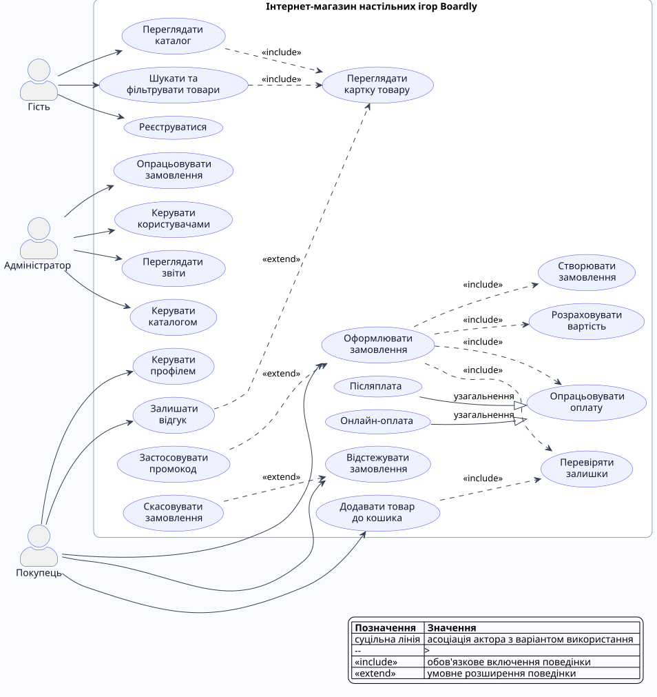
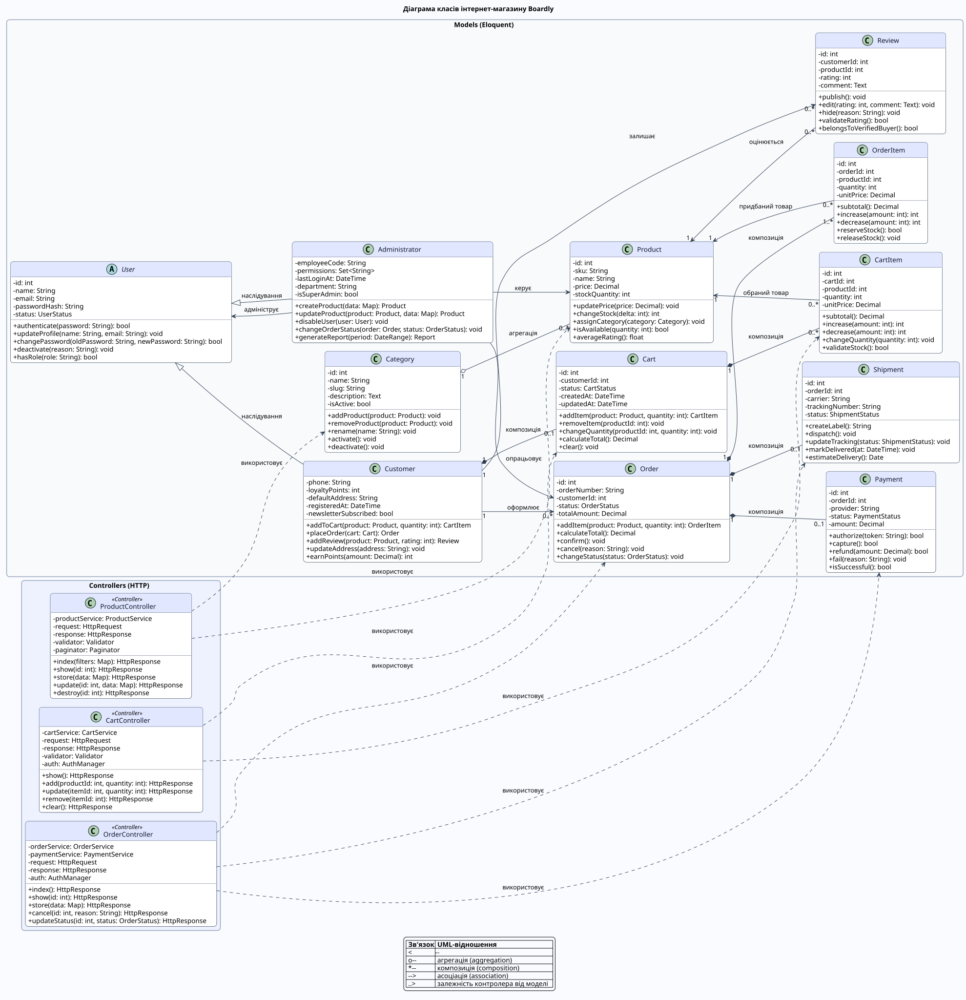

# Проєктування веб-системи Boardly

## 1. Предметна галузь

**Boardly** - веб-система інтернет-магазину настільних ігор, у якій відвідувач може знайти гру за жанром, кількістю гравців, віком і ціною, а зареєстрований покупець - сформувати кошик, оплатити замовлення, відстежувати доставку та залишати відгуки. Адміністратор підтримує каталог, контролює замовлення і користувачів та отримує аналітичні звіти.

### 1.1 Призначення та основні функції

Система призначена для автоматизації онлайн-продажу настільних ігор. Основні функції:

1. реєстрація, автентифікація та керування профілем покупця;
2. перегляд каталогу, пошук і багатокритеріальна фільтрація товарів;
3. формування кошика з перевіркою актуальних складських залишків;
4. оформлення замовлення, розрахунок суми та застосування промокоду;
5. безпечне опрацювання онлайн-оплати;
6. створення відправлення та відстеження статусу доставки;
7. публікація оцінок і відгуків про придбані товари;
8. адміністрування каталогу, замовлень і користувачів;
9. формування звітів про продажі, залишки та популярність товарів.

### 1.2 Користувачі системи

| Користувач | Можливості |
|---|---|
| Гість | Перегляд каталогу, пошук і фільтрація, перегляд картки товару, реєстрація |
| Покупець | Усі можливості гостя, кошик, оформлення і відстеження замовлень, профіль, відгуки |
| Адміністратор | Керування каталогом, замовленнями й користувачами, перегляд звітів |

### 1.3 Архітектура

Система проєктується за архітектурним патерном **MVC**, типовим для Laravel:

- **Model** - Eloquent-моделі `User`, `Product`, `Category`, `Cart`, `Order`, `Payment` та інші класи предметної галузі;
- **View** - Blade-шаблони каталогу, картки товару, кошика, оформлення замовлення та адміністративної панелі;
- **Controller** - `ProductController`, `CartController`, `OrderController`, які приймають HTTP-запити, запускають прикладну логіку й формують відповіді.

### 1.4 Основні сценарії роботи

1. **Пошук товару:** користувач відкриває каталог, задає фільтри та переглядає картку вибраної гри.
2. **Оформлення замовлення:** покупець додає товари до кошика, зазначає адресу, вибирає доставку й оплату та підтверджує замовлення.
3. **Опрацювання замовлення:** адміністратор перевіряє оплату, комплектує замовлення, створює відправлення та змінює його статус.
4. **Керування каталогом:** адміністратор додає або редагує товар, змінює залишок і категорію.
5. **Публікація відгуку:** покупець після отримання замовлення оцінює придбаний товар і залишає коментар.

### 1.5 Логічні сутності й таблиці бази даних

| Сутність | Таблиця | Призначення |
|---|---|---|
| User | `users` | Облікові записи покупців та адміністраторів |
| Category | `categories` | Категорії настільних ігор |
| Product | `products` | Товари, ціни та складські залишки |
| Cart | `carts` | Активні кошики покупців |
| CartItem | `cart_items` | Позиції кошика |
| Order | `orders` | Заголовки замовлень і статуси |
| OrderItem | `order_items` | Придбані товари, кількість і ціна |
| Payment | `payments` | Дані про платіжні транзакції |
| Shipment | `shipments` | Дані доставки та трекінгу |
| Review | `reviews` | Оцінки й коментарі покупців |

### 1.6 Вихідні дані

1. таблиця замовлень із сумами, статусами оплати й доставки;
2. звіт про продажі за вибраний період;
3. звіт про складські залишки та товари, що закінчуються;
4. графік динаміки виторгу за днями або місяцями;
5. рейтинг найпопулярніших і найкраще оцінених ігор.

## 2. Варіанти використання

### 2.1 Коротка форма: «Знайти настільну гру»

Гість відкриває каталог, вводить назву гри або задає фільтри за жанром, віком, кількістю гравців і ціною. Система відображає відповідні доступні товари. Користувач відкриває картку обраної гри та переглядає її опис, характеристики, ціну, залишок і відгуки.

### 2.2 Поверхнева форма: «Керувати каталогом товарів»

**Головний сценарій.** Адміністратор авторизується, відкриває розділ керування каталогом, додає нову настільну гру, указує артикул, назву, категорію, опис, ціну та кількість на складі. Система перевіряє дані, зберігає товар і публікує його в каталозі.

**Альтернативні сценарії:**

1. артикул уже існує - система не зберігає товар і пропонує змінити SKU;
2. обов'язкове поле не заповнене - система підсвічує помилку валідації;
3. ціна або залишок мають некоректне значення - система відхиляє дані;
4. адміністратор редагує наявний товар замість створення нового;
5. товар тимчасово недоступний - адміністратор деактивує його без видалення історичних даних;
6. виник збій збереження - система не змінює каталог і реєструє помилку в журналі.

### 2.3 Повна форма: «Оформити замовлення»

| Параметр | Опис |
|---|---|
| **Use Case Name** | Оформити замовлення |
| **Scope** | Інтернет-магазин Boardly (System) |
| **Level** | User-goal |
| **Primary Actor** | Покупець |
| **Stakeholders and interests** | Покупець очікує правильного складу й суми замовлення, безпечної оплати та прогнозованої доставки. Магазин зацікавлений в оплаті, коректному обліку залишків і можливості виконати замовлення. Адміністратор очікує повних даних для комплектування. Платіжний провайдер зацікавлений у валідному та захищеному запиті. Служба доставки потребує правильної адреси й контактних даних. |
| **Preconditions** | Покупець авторизований; кошик містить хоча б один товар; товари активні; система має зв'язок із базою даних. |
| **Success guarantee** | Замовлення створене з унікальним номером; оплата зафіксована; залишки зарезервовані; покупцеві надіслано підтвердження. |
| **Frequency of Occurrence** | Приблизно 35% активних сеансів зареєстрованих покупців. |
| **Special Requirements** | HTTPS; відповідь сторінки до 2 секунд без урахування зовнішньої оплати; суми зберігаються з точністю до 0,01; критичні операції виконуються в транзакції БД. |
| **Technology and Data Variations List** | Laravel Validation для перевірки даних, Eloquent ORM і транзакції БД, інтеграція з API платіжного провайдера та служби доставки. |
| **Miscellaneous** | Значення податків, доставки та знижок мають зберігатися разом із замовленням для подальшого аудиту. |

#### Головний успішний сценарій

1. Покупець відкриває кошик.
2. Система завантажує позиції кошика та актуальні дані про товари.
3. Система перевіряє доступність потрібної кількості кожного товару.
4. Система розраховує вартість позицій і попередню загальну суму.
5. Покупець переходить до оформлення замовлення.
6. Система відображає форму контактних даних, адреси та способів доставки.
7. Покупець перевіряє контактні дані, вводить адресу й обирає спосіб доставки.
8. Система перевіряє введені дані та розраховує вартість доставки.
9. Покупець обирає спосіб оплати.
10. Система повторно обчислює остаточну суму замовлення.
11. Покупець підтверджує замовлення та переходить до оплати.
12. Система передає платіжному провайдеру суму та ідентифікатор операції.
13. Платіжний провайдер успішно авторизує платіж.
14. Система в межах транзакції створює замовлення і його позиції, зберігає платіж та резервує складські залишки.
15. Система очищує кошик покупця.
16. Система відображає номер замовлення та надсилає покупцеві підтвердження.

#### Розширення та альтернативні сценарії

1. **3a. Недостатньо товару на складі:** система показує доступну кількість, пропонує змінити кошик і не дозволяє продовжити оформлення.
2. **6a. У профілі немає адреси:** покупець вводить нову адресу, система перевіряє та зберігає її за згодою користувача.
3. **8a. Адреса поза зоною доставки:** система повідомляє про обмеження й пропонує інший спосіб або адресу доставки.
4. **10a. Покупець вводить промокод:** система перевіряє термін дії й умови промокоду та перераховує остаточну суму.
5. **10b. Промокод недійсний:** система пояснює причину, не застосовує знижку й дозволяє продовжити без неї.
6. **13a. Платіж відхилено:** система не створює підтверджене замовлення, показує повідомлення та пропонує повторити оплату або вибрати інший спосіб.
7. **13b. Платіжний сервіс не відповідає:** система позначає спробу як невизначену, не списує залишки та пропонує повторити операцію пізніше.
8. **14a. Товар став недоступним під час оплати:** система скасовує транзакцію створення замовлення, ініціює повернення авторизованої суми та повідомляє покупця.
9. **14b. Помилка бази даних:** система відкочує транзакцію, зберігає технічний запис у журналі та показує безпечне повідомлення про помилку.
10. **16a. Не вдалося надіслати лист:** замовлення залишається успішним, а повідомлення додається до черги повторного надсилання.

## 3. Діаграма варіантів використання

Діаграма охоплює трьох акторів і демонструє асоціацію, узагальнення акторів, обов'язкове включення `include` та умовне розширення `extend`.

Вихідний код PlantUML: [`use-case-diagram.puml`](use-case-diagram.puml).

## 4. Діаграма класів

Діаграма містить 15 класів: 12 моделей предметної галузі й 3 MVC-контролери. Для кожного класу визначено щонайменше п'ять атрибутів і п'ять операцій. На діаграмі використано асоціацію, агрегацію, композицію, наслідування і залежності контролерів від моделей.

Вихідний код PlantUML: [`class-diagram.puml`](class-diagram.puml).

## 5. Відображення проєкту на Laravel

- класи пакета `Models` перетворюються на Eloquent-моделі та міграції відповідних таблиць;
- зв'язки `Customer -> Order`, `Category -> Product`, `Order -> OrderItem` реалізуються методами `hasMany`, `belongsTo`, `hasOne`;
- композиційні складові видаляються каскадно або обробляються в доменному сервісі;
- контролери приймають HTTP-запити, використовують Form Request для валідації та повертають Blade-представлення або JSON;
- створення замовлення, платежу й резервування залишків виконується в одній транзакції БД;
- інтеграції оплати й доставки інкапсулюються сервісними класами та викликаються з прикладного шару.

## 6. Висновок

Спроєктована структура Boardly визначає межі майбутнього Laravel-застосунку, ролі користувачів, функціональні сценарії, основні таблиці та взаємодію класів. Use Case-модель фіксує поведінкові вимоги, а діаграма класів формує основу для Eloquent-моделей, контролерів і міграцій бази даних.
