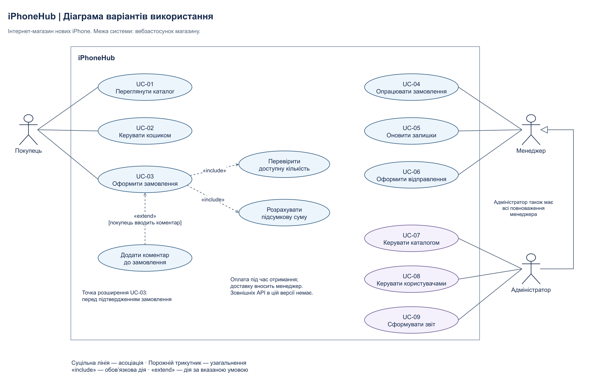
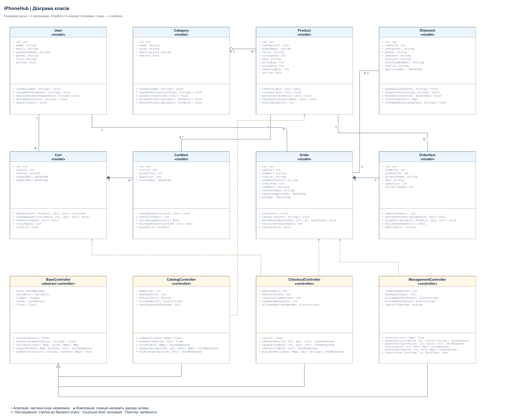

# iPhoneHub — проєктування інтернет-магазину iPhone

Лабораторна робота №2 з дисципліни «Веб-програмування». Варіант 7 — «Інтернет-магазин».

Виконав: Томенко Віталій Ігорович. Тема: продаж нових смартфонів Apple iPhone.

## 1. Мета та межі системи

Мета роботи — проаналізувати предметну галузь, визначити функціональні вимоги, описати три різні Use Case та побудувати UML-діаграми як основу майбутнього застосунку PHP/Laravel.

iPhoneHub автоматизує вибір iPhone, ведення кошика, оформлення замовлення, резервування залишків та роботу персоналу магазину. Кожна комбінація моделі, кольору й пам’яті є окремою товарною позицією з унікальним SKU. Наприклад, iPhone 15 / 128 GB / Black та iPhone 15 / 256 GB / Black — різні записи Product. Назви моделей наведено як приклади, а не як заяву про актуальний асортимент або ціни.

Межі першої версії: нові iPhone, один склад, валюта UAH, зареєстровані покупці для оформлення замовлення, оплата під час отримання. Доставку та номер накладної вносить менеджер вручну; доставка оплачується перевізнику окремо. Зовнішній платіжний API, обмін уживаних телефонів і кредитування не входять до цієї версії. Тому кур’єр та платіжний сервіс не є акторами вебсистеми: безпосередньої взаємодії з нею немає.

## 2. Аналіз предметної галузі

### 2.1 Функціональні вимоги

| Код | Функція | Результат |
|---|---|---|
| FR-01 | Перегляд і фільтрація каталогу за моделлю, пам’яттю, кольором та ціною | Список відповідних iPhone |
| FR-02 | Додавання, зміна кількості та видалення позицій кошика | Актуальний склад кошика і сума |
| FR-03 | Оформлення замовлення з контактами й адресою | Номер замовлення, зафіксовані ціни, резерв |
| FR-04 | Перевірка й підтвердження замовлень менеджером | Статус confirmed або cancelled |
| FR-05 | Облік надходжень і коригування залишків | Доступна кількість для продажу |
| FR-06 | Створення відправлення і оновлення його статусу | Накладна та інформація про доставку |
| FR-07 | Створення, редагування та архівування товарів | Оновлений каталог |
| FR-08 | Керування обліковими записами та ролями | Контроль доступу до службових операцій |
| FR-09 | Формування звіту за період | Таблиця продажів і графік виручки |

### 2.2 Користувачі й актори

Актор — це роль, у якій людина взаємодіє із системою, а не конкретна людина або клас програми. Визначено рівно три ролі користувачів.

| Актор | Призначення | Три основні варіанти використання |
|---|---|---|
| Покупець | Обирає та замовляє iPhone | UC-01 «Переглянути каталог», UC-02 «Керувати кошиком», UC-03 «Оформити замовлення» |
| Менеджер | Опрацьовує продажі й роботу складу | UC-04 «Опрацювати замовлення», UC-05 «Оновити залишки», UC-06 «Оформити відправлення» |
| Адміністратор | Керує каталогом, доступом і звітністю | UC-07 «Керувати каталогом», UC-08 «Керувати користувачами», UC-09 «Сформувати звіт» |

Адміністратор додатково має всі повноваження менеджера; це правило відображено узагальненням акторів. У реалізації ролі зберігатимуться у полі users.role, а дозволи перевірятимуться політиками доступу. Наслідування акторів UML не означає необхідності створити окремі таблиці для менеджера та адміністратора.

### 2.3 Архітектура MVC

| Частина MVC | Компоненти iPhoneHub | Відповідальність |
|---|---|---|
| Model | User, Category, Product, Cart, CartItem, Order, OrderItem, Shipment | Дані, інваріанти, зв’язки та операції предметної галузі |
| View | catalog/index, catalog/show, cart/show, checkout/create, orders/show, management/orders, management/reports | Blade-представлення каталогу, кошика, замовлень і службової панелі |
| Controller | CatalogController, CheckoutController, ManagementController; спільний BaseController | Обробка HTTP-запиту, перевірка доступу і даних, координація моделей, відповідь |

Послідовність запиту: браузер → маршрут і middleware → контролер → моделі та БД → Blade View або JSON → браузер. Базовий контролер є абстрактним: його безпосередні екземпляри не створюються. Його атрибути — залежності, а атрибути конкретних контролерів — параметри обробки запитів. Вони не є полями таблиць БД.

Оформлення замовлення виконується транзакційно. Сервер блокує потрібні записи товарів, перевіряє їх доступність, створює замовлення та його позиції, встановлює резерв і очищає кошик. Клієнтська ціна не використовується як довірене джерело. Команди надходять через контролер, а перевірки залишку належать моделі Product.

### 2.4 Основні сценарії роботи

1. Покупець застосовує фільтри каталогу, відкриває картку iPhone, додає потрібну конфігурацію до кошика, вводить адресу та підтверджує замовлення.
2. Менеджер переглядає нові замовлення, перевіряє контакти й резерв, підтверджує замовлення, створює відправлення та вносить номер накладної.
3. Адміністратор створює категорію і товарні конфігурації iPhone, вказує унікальні SKU, ціни й початкові залишки, після чого публікує товари.
4. Менеджер опрацьовує скасування невідправленого замовлення; система звільняє резерв, зберігаючи історію та позиції замовлення.
5. Адміністратор обирає період і отримує звіт про доставлені й оплачені замовлення, продані одиниці та виручку за днями.

### 2.5 Логічні сутності та таблиці БД

| Сутність / таблиця | Основні поля | Обмеження і зв’язки |
|---|---|---|
| User / users | id, name, email, password_hash, phone, role, active, created_at, updated_at | PK id; UNIQUE email; роль buyer/manager/admin |
| Category / categories | id, name, slug, description, active | UNIQUE slug; категорія об’єднує товари |
| Product / products | id, category_id, model_name, color, storage_gb, sku, price_kop, stock_qty, reserved_qty, active | UNIQUE sku; FK category_id nullable; price_kop > 0; 0 ≤ reserved_qty ≤ stock_qty |
| Cart / carts | id, user_id, status, created_at, updated_at | UNIQUE user_id; FK user_id; один активний кошик покупця |
| CartItem / cart_items | id, cart_id, product_id, quantity, created_at | UNIQUE(cart_id, product_id); quantity > 0; FK cart_id, product_id |
| Order / orders | id, user_id, number, status, payment_status, total_kop, comment, checkout_key, reserve_expires_at, paid_at, created_at | UNIQUE number; UNIQUE checkout_key; FK user_id; total_kop ≥ 0; paid_at nullable до оплати |
| OrderItem / order_items | id, order_id, product_id, product_name, sku, quantity, unit_price_kop | FK order_id, product_id; quantity > 0; ціна і назва зафіксовані при покупці |
| Shipment / shipments | id, order_id, recipient, phone, address, carrier, tracking_number, status, delivered_at | UNIQUE order_id; FK order_id; одна доставка на замовлення; delivered_at nullable до вручення |

Числа з грошовими сумами зберігаються цілими у копійках: 29 999,00 грн = 2 999 900 коп. Це виключає похибки двійкового дробового представлення для підсумків. Дати зберігаються в UTC; для українського магазину звітний день визначається у часовому поясі Europe/Kyiv.

Видалення категорії встановлює products.category_id = NULL: товар зберігає самостійне існування. Товари і користувачі з історією замовлень деактивуються, а не фізично видаляються. Видалення кошика каскадно видаляє його позиції. Позиції замовлення належать лише одному замовленню, але скасування змінює його статус і не видаляє історію.

### 2.6 Вихідні дані

| Код | Форма результату | Поля / вимірювання | Одержувач |
|---|---|---|---|
| OUT-01 | Таблиця каталогу | Модель, SKU, пам’ять, колір, ціна, доступність | Покупець |
| OUT-02 | Підтвердження замовлення | Номер, позиції, кількість, зафіксовані ціни, підсумок, адреса, спосіб оплати | Покупець |
| OUT-03 | Складський звіт | SKU, фізичний залишок, резерв, доступна кількість | Менеджер |
| OUT-04 | Звіт про продажі | Період, кількість доставлених і оплачених замовлень, кількість iPhone, виручка | Адміністратор |
| OUT-05 | Лінійний графік | Вісь X — день; вісь Y — виручка у гривнях за доставленими й оплаченими замовленнями | Адміністратор |

### 2.7 Бізнес-правила

1. Доступна кількість = stock_qty − reserved_qty. Кошик не резервує товар.
2. Остаточна перевірка ціни і залишку відбувається на сервері під час транзакції оформлення.
3. Повторний запит з тим самим checkout_key повертає створене раніше замовлення та не резервує товар удруге. Ключ прив’язується до авторизованого покупця; чужий ключ відхиляється.
4. Нове замовлення має status = pending та payment_status = unpaid. Оформлення з оплатою при отриманні не означає, що замовлення вже оплачене.
5. Після підтвердження менеджером замовлення переходить у confirmed. Під час відправлення фізичний залишок і резерв зменшуються на однакову кількість.
6. Скасувати можна pending або confirmed; резерв звільняється один раз. Для відправленого замовлення потрібен окремий процес повернення, що виходить за межі першої версії.
7. Резерв pending-замовлення діє 30 хвилин. Планувальник скасовує прострочені замовлення; у тій самій транзакції перевіряє статус, щоб не скасувати вже підтверджене замовлення.
8. Після доставки менеджер окремо підтверджує факт оплати і фіксує paid_at; факт вручення фіксується у delivered_at. До виручки входять лише записи delivered + paid. Замовлення, за які не отримано оплату, не включаються. Виручка за днями групується за paid_at у часовому поясі Europe/Kyiv.
9. Зміна ціни або назви Product не змінює знімок даних у вже створеному OrderItem.
10. Перед архівуванням товару перевіряється відсутність активного резерву; історичні позиції зберігаються.

## 3. Три форми Use Case

### 3.1 UC-01 «Переглянути каталог» — коротка форма

Покупець відкриває каталог iPhone, задає модель, обсяг пам’яті, колір і діапазон ціни. Система відбирає активні товарні конфігурації та показує їх характеристики, ціну й доступну кількість. Покупець відкриває картку вибраного iPhone і отримує інформацію для прийняття рішення про покупку. Вхід до облікового запису для перегляду каталогу не потрібен.

### 3.2 UC-07 «Керувати каталогом» — поверхнева форма

Головний актор — адміністратор. Передумова — успішний вхід до службової панелі та наявність дозволу керування каталогом.

Основний сценарій: адміністратор відкриває каталог у панелі, обирає створення товару, задає модель iPhone, пам’ять, колір, SKU, категорію, ціну та залишок. Система перевіряє дані; після підтвердження зберігає товар і робить його доступним у каталозі. Для редагування адміністратор обирає наявний товар, змінює значення та зберігає їх. Архівування приховує товар з каталогу, зберігаючи історію продажів.

Альтернативи: дубльований SKU — виправлення коду; некоректна ціна чи від’ємний залишок — повідомлення біля поля; невказана категорія — збереження без категорії; активний резерв під час архівування — відмова з поясненням; відсутні права — відмова в доступі; помилка БД — відкат змін і пропозиція повторити запит.

Результат — каталог оновлено або дані залишилися незмінними з повідомленням про причину відмови.

### 3.3 UC-03 «Оформити замовлення» — повна форма

#### Назва (Use Case Name)

Оформити замовлення iPhone з оплатою під час отримання.

#### Область дії (Scope)

System: вебсистема iPhoneHub, від переходу до оформлення до збереження замовлення і показу його номера. Фізична доставка й фактична оплата відбуваються пізніше.

#### Рівень (Level)

User-goal — самостійна мета покупця.

#### Головний актор (Primary Actor)

Покупець з активним обліковим записом. Тригер — натискання «Оформити замовлення» у кошику.

#### Зацікавлені особи та інтереси (Stakeholders and interests)

- Покупець: правильна конфігурація iPhone, зрозуміла сума, збереження замовлення без дублювання.
- Менеджер: достовірні контакти, адреса і резерв для подальшого підтвердження та відправлення.
- Власник магазину: відсутність продажу одного залишку двом покупцям і коректна історія цін.
- Адміністратор: контроль прав доступу, журнал помилок і можливість відтворити стан після збою.

#### Передумови (Preconditions)

Покупець авторизований; обліковий запис активний; його кошик містить принаймні одну позицію. Наявність достатнього залишку не є передумовою: система обов’язково перевіряє її у сценарії, бо залишок може змінитися.

#### Гарантія успіху (Success guarantee)

У БД існує одне замовлення з унікальним номером, позиціями та зафіксованими цінами; створено запис запланованої доставки; товари зарезервовані; кошик очищено; покупець бачить номер і суму. Статус замовлення — pending, оплати — unpaid.

Мінімальна гарантія при невдачі: часткові зміни не зберігаються, зайвий резерв не виникає, кошик залишається доступним. Технічна помилка фіксується без паролів та зайвих персональних даних.

#### Основний успішний сценарій (Main Success Scenario)

1. Покупець натискає «Оформити замовлення» у своєму кошику.
2. Система перевіряє сесію, активність облікового запису і належність кошика.
3. Система показує позиції, характеристики, кількість і поточні ціни з БД.
4. Система перевіряє, що товари активні та мають достатню доступну кількість.
5. Покупець вводить або підтверджує ім’я одержувача й номер телефону.
6. Покупець обирає службу доставки та вводить адресу або відділення.
7. Система перевіряє формат і заповнення контактних даних та адреси.
8. Система встановлює спосіб оплати «Під час отримання» і повідомляє, що доставка оплачується окремо.
9. Система розраховує підсумок товарів у копійках і показує його у гривнях.
10. Система показує підсумкові дані та форму підтвердження; на цьому кроці доступне умовне розширення «Додати коментар».
11. Покупець підтверджує склад, суму та адресу замовлення.
12. Система приймає ключ ідемпотентності checkout_key і перевіряє, чи немає вже створеного замовлення для цього покупця та ключа.
13. Система починає транзакцію, блокує кошик і потрібні записи Product у стабільному порядку за id, повторно перевіряє ціну та залишки.
14. Система створює Order, OrderItem зі знімками назв/SKU/цін та Shipment зі статусом planned.
15. Система збільшує reserved_qty для товарів, визначає час закінчення резерву і очищає позиції кошика.
16. Система фіксує транзакцію; замовлення доступне менеджеру для опрацювання.
17. Система показує покупцеві номер, склад, суму й статус замовлення та повідомлення «Очікує підтвердження менеджером».

#### Альтернативні сценарії (Extensions)

| Код / крок | Умова | Дії та завершення |
|---|---|---|
| 2a | Сесія завершилася | Перехід до входу; кошик зберігається. Після входу — повернення до кроку 1. |
| 2b | Обліковий запис заблокований або кошик чужий | Доступ відхиляється; замовлення не створюється. |
| 3a | Кошик став порожнім | Показ повідомлення і повернення до каталогу. |
| 4a / 13a | Товар неактивний або залишку недостатньо | Система показує недоступні позиції й пропонує виправити кошик. Транзакція, якщо вже почалася, відкочується; повернення до кроку 3. |
| 7a | Некоректний телефон чи неповна адреса | Помилки біля відповідних полів; повернення до кроку 5 або 6. |
| 10a | Покупець бажає залишити коментар | Розширення «Додати коментар»: вводиться текст до 500 символів; система перевіряє його і повертається до кроку 11. Порожній коментар не блокує оформлення. |
| 11a | Покупець скасовує оформлення | Повернення до кошика. Резерв ще не створений, тому звільняти його не потрібно. |
| 12a | Повторне натискання кнопки чи повтор запиту | Для того самого покупця повертається раніше створене замовлення; кошик і резерв повторно не змінюються. Для конкурентних запитів спрацьовує UNIQUE checkout_key. |
| 13b | Ціна змінилася після попереднього перегляду | Відкат, показ нової суми і запит повторного підтвердження; повернення до кроку 9. |
| 14–16a | Помилка запису або тайм-аут БД до commit | Повний rollback, кошик збережено, резерв не збільшено; безпечне повідомлення та повтор із тим самим ключем. |
| 17a | Відповідь загубилася після commit | Повтор із тим самим checkout_key повертає збережений номер; нового замовлення немає. |
| *a | Виникла неочікувана помилка | Користувач отримує ідентифікатор звернення; подробиці зберігаються в журналі. Стан визначається наявністю commit, а не фактом показу сторінки. |

#### Спеціальні вимоги (Special Requirements)

Доступ до чужих кошиків і замовлень забороняється перевірками на сервері. Передавання даних виконується через HTTPS, введені значення перевіряються, а виведення коментарів екранується. Резервування і створення замовлення атомарні. Проєктна ціль: 95 % запитів оформлення до 3 секунд за 50 одночасних користувачів на тестовому стенді. Це вимога до майбутньої реалізації, а не результат виконаного навантажувального тесту. Форма має бути придатною для телефона і керування клавіатурою.

#### Технологічні та інформаційні варіації (Technology and Data Variations List)

Вхідні дані можуть надходити з HTML-форми або JSON-запиту; обидва шляхи застосовують однакові правила. Телефон нормалізується до міжнародного формату. Адреса містить населений пункт та відділення або вулицю, будинок і квартиру. Грошові значення — цілі копійки, ідентифікатори — цілі числа, checkout_key — UUID-рядок. Коментар обмежується 500 символами. Основний варіант БД — PostgreSQL; транзакції та блокування перевірятимуться на обраному рушії під час реалізації.

#### Частота виконання (Frequency of Occurrence)

Проєктне припущення: оформлення ініціюють приблизно 10 % сесій перегляду каталогу; одне підтвердження відповідає одному замовленню. Відсоток умовний і має бути уточнений за аналітикою після запуску.

#### Додаткові питання (Miscellaneous)

Час ручного підтвердження менеджером і перелік перевізників визначатимуться перед запуском. Для навчальної моделі резерв pending-замовлення діє 30 хвилин, максимальна кількість однієї позиції — 5 одиниць, кількість різних позицій — 20. Онлайн-оплата і повернення після відправлення можуть бути окремими наступними Use Case.

Післяумови: при успіху виконується гарантія успіху; при відмові до commit стан замовлень і резервів не змінюється. Якщо commit відбувся, замовлення існує навіть за втраченої HTTP-відповіді.

## 4. Діаграма варіантів використання

[Відкрити SVG](diagrams/use-case-diagram.svg) · [Редагований файл draw.io](diagrams/use-case-diagram.drawio)

На діаграмі три актори, дев’ять основних варіантів використання і три допоміжні. Кожен актор безпосередньо поєднаний асоціаціями з трьома своїми основними варіантами.

| Тип зв’язку | Приклад | Напрям і зміст |
|---|---|---|
| Асоціація | Покупець — «Керувати кошиком» | Суцільна лінія показує участь актора |
| Узагальнення | Адміністратор → Менеджер | Порожній трикутник спрямований до загальної ролі; адміністратор успадковує її можливості |
| include | «Оформити замовлення» → «Перевірити доступну кількість» | Пунктирна стрілка до обов’язкової включеної дії |
| include | «Оформити замовлення» → «Розрахувати підсумкову суму» | Розрахунок завжди виконується при оформленні |
| extend | «Додати коментар» → «Оформити замовлення» | Пунктирна стрілка до базового сценарію; умова — покупець вводить коментар перед підтвердженням |

## 5. Діаграма класів

[Відкрити повну схему SVG](diagrams/class-diagram.svg) · [Редагований файл draw.io](diagrams/class-diagram.drawio)

Побудовано 12 класів: 8 моделей і 4 контролери. У кожного є власні щонайменше 5 атрибутів і 5 операцій; успадковані члени не використано для штучного досягнення мінімуму. Назви класів англійські в однині. Атрибути записано як name: Type, операції — operation(argument: Type): ReturnType.

Для читання великим шрифтом передбачено детальні аркуші з тими самими визначеннями класів:

- [Облікові записи і каталог](diagrams/class-accounts-catalog.png) · [draw.io](diagrams/class-accounts-catalog.drawio).
- [Кошик і замовлення](diagrams/class-orders.png) · [draw.io](diagrams/class-orders.drawio).
- [Контролери MVC](diagrams/class-controllers.png) · [draw.io](diagrams/class-controllers.drawio).

### 5.1 Семантика зв’язків

| Відношення | Зв’язок і кратність | Обґрунтування |
|---|---|---|
| Асоціація | User 1 — 0..* Order | Одне замовлення має одного покупця; покупець може не мати замовлень або мати багато |
| Асоціація | User 1 — 0..1 Cart | Один активний кошик належить одному покупцеві |
| Агрегація | Category 0..1 ◇— 0..* Product | Категорія групує товари, але товар може існувати без категорії |
| Композиція | Cart 1 ◆— 0..* CartItem | Позиція кошика не має самостійного життєвого циклу |
| Композиція | Order 1 ◆— 1..* OrderItem | Позиція належить одному конкретному замовленню; порожнє замовлення не створюється |
| Асоціація | Product 1 — 0..* CartItem / OrderItem | Позиції посилаються на товар; історичні дані замовлення збережені окремим знімком |
| Асоціація | Order 1 — 0..1 Shipment | Замовлення має не більш як одне відправлення; до підготовки воно може бути відсутнім |
| Наслідування | CatalogController, CheckoutController, ManagementController → BaseController | Контролери успадковують спільні допоміжні операції й залежності |
| Залежність | Контролери → моделі | Пунктирні стрілки позначають використання моделей при обробці запитів |

Між Shipment і Order застосовано асоціацію: запис доставки відображає окремий процес і статус, а не товарну позицію. Для повернень або кількох посилок знадобиться розширення моделі.

### 5.2 Пояснення типів і реалізації в Laravel

int, string, bool — скалярні типи; ?T — значення T або null; DateTime — час; Map — асоціативний масив; List<T> — список елементів. View і JsonResponse — типи відповіді фреймворку. AuthManager, Validator, Logger, CacheStore і Clock — інфраструктурні залежності, визначення яких не розгорнуті на цій предметній діаграмі.

Моделі відповідають таблицям, а поля camelCase — колонкам snake_case. Колекції зв’язків не дублюються як скалярні поля: вони задаються кінцями асоціацій. У Laravel зв’язки плануються через belongsTo, hasOne та hasMany. Наслідування контролерів реалізується звичайним extends. Композиція визначає правила володіння, але сама назва ORM-методу не забезпечує їх: потрібні зовнішні ключі, каскади й бізнес-обмеження.

Атрибути контролерів є залежностями та конфігурацією; для них не створюються таблиці. Конкретні контролери використовують політики доступу: доступ до служби каталогу, користувачів і звіту — адміністратору, до обробки замовлень — менеджеру та адміністратору. Метод OrderItem.snapshot виконується тільки при створенні позиції; після оформлення знімок не редагується.

## 6. Перевірка проєктних сценаріїв

Це критерії приймання майбутньої реалізації, а не твердження про вже запущені програмні тести.

| Перевірка | Очікуваний результат |
|---|---|
| Замовити один доступний iPhone | Одне pending/unpaid замовлення, одна позиція, резерв +1, кошик очищений |
| Двоє покупців замовляють останній iPhone | Лише один резерв; другий отримує повідомлення про відсутність |
| Двічі відправити однаковий checkout_key | Один номер замовлення, одноразове резервування |
| Змінити ціну після відкриття кошика | Повторне підтвердження нової суми, без мовчазного підвищення |
| Скасувати підтверджене невідправлене замовлення | Резерв звільнений один раз, історія збережена |
| Запитати чуже замовлення | Відмова в доступі |
| Прибрати категорію | Товар залишається; category_id стає NULL |
| Змінити назву товару після продажу | Старий OrderItem зберігає початкову назву і ціну |

## 7. Файли та публікація

Редаговані оригінали знаходяться у diagrams/*.drawio, експортовані зображення — у diagrams/*.png і diagrams/*.svg. Файли відкриваються у [draw.io](https://app.diagrams.net/) через «Файл → Відкрити з → Пристрій».

Документація лабораторної роботи №2 зберігається в папці docs/ репозиторію лабораторної роботи №1. Зміни оформлюються через гілку feature/system-design і Pull Request до main з перевіркою GitHub Actions.

## 8. Висновки

Спроєктовано інтернет-магазин нових iPhone: визначено межі системи, дев’ять функцій, три ролі, вісім сутностей і таблиць та п’ять видів вихідних даних. Написано три різні Use Case; повний сценарій містить 17 кроків і 12 альтернатив. UML-діаграми відображають обов’язкові, умовні та успадковані можливості, структуру моделей і контролерів, а також кратності зв’язків. Окремо визначено транзакційне резервування, захист від дублювання замовлень і збереження історичних цін. Модель придатна як основа подальшої реалізації на PHP/Laravel.

## 9. Джерела

1. Методичні вказівки «Лабораторна робота 2. Проєктування веб-системи», надані до завдання, с. 19–22.
2. [OMG UML 2.5.1 — специфікація UML](https://www.omg.org/spec/UML/2.5.1).
3. [Laravel — Eloquent Relationships](https://laravel.com/docs/12.x/eloquent-relationships). Використано для пояснення способу відображення зв’язків.
4. [draw.io — формати збереження](https://www.drawio.com/docs/manual/editor/save-file-formats/).
5. [draw.io — протокол вбудованого редактора та експорту](https://www.drawio.com/docs/reference/embed-mode/).
